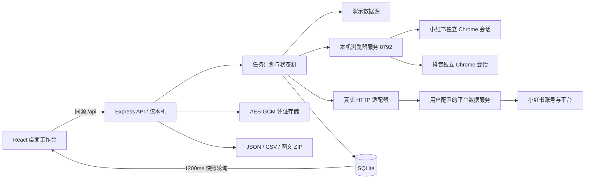
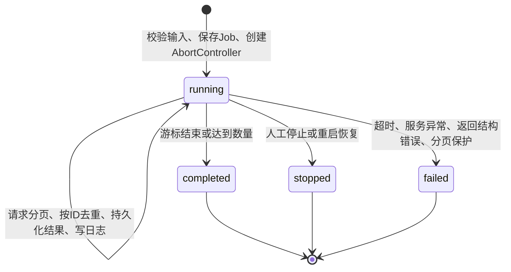

# OpenFind 工程架构与业务原理

本文件描述的是已实现的 OpenFind，不是对参考产品未知源码的断言。

## 1. 系统分层



前端是轻量单页应用，hash路由可刷新与分享本地地址。主框架由固定侧栏、面包屑和工作区构成；作品区使用CSS多列瀑布流。弹窗支持Esc、焦点捕获和返回焦点；桌面、平板、手机布局均有适配，窄屏保留所有导航功能。操作反馈有成功提示、失败提示、禁用和忙碌状态。

使用 React 的本地状态维护编辑、筛选和临时选中项。`WorkspaceContext` 提供服务器快照与通用操作。每1200ms取一次状态，任务和数据都由服务器持有；浏览器刷新不会丢失任务。任务进行时，其他页面也能看见运行提示。

框架依据：[React 官方文档](https://react.dev/learn)、[Vite 官方文档](https://vite.dev/guide/)、[Node SQLite 官方文档](https://nodejs.org/api/sqlite.html)。具体依赖版本由根目录 package-lock.json 锁定。

## 2. 文件结构

```text
src/
  App.tsx                  导航、全局快照、通知、全局弹窗
  context.tsx              工作区依赖
  api.ts                   HTTP、导出、下载辅助
  components/
    Discover.tsx           搜索、卡片、详情、筛选、批量下载、日志
    Customers.tsx          评论终端/表格、详情、线索库、跟进
    Studio.tsx             草稿库和图文编辑器
    Accounts.tsx           新增账号
    System.tsx             连接设置、任务记录、指南
    ui.tsx                 无障碍弹窗、空状态、忙碌状态
  styles.css               完整样式与响应式布局
server/
  index.ts                 API、校验、任务运行、导出与发布
  browser-service.ts       独立浏览器进程、认证本机 RPC
  platforms/browser.ts     官方网页登录、搜索、翻页、详情与评论
  platforms/model.ts       两个平台的数据归一化
  platforms/publish.ts     官方编辑器、素材上传、发布回执与防重复
  platforms/client.ts      API 到浏览器进程的本机调用
  store.ts                 SQLite持久化、加密与配置
  provider.ts              真实数据源协议、超时与取消
  demo.ts                  明确标记来源的演示数据
  domain.ts                任务解析、意向规则、线索转换
shared/types.ts            前后端实体契约
public/assets/             原创演示封面
analysis/                  本机视频分析脚本；取帧、OCR和验收截图不提交仓库
tests/                     接口/业务测试和浏览器验收
```

## 3. 数据模型

SQLite采用统一实体表 `entities(kind, id, value)`，主键 `(kind,id)`；结构化数据由JSON保存，字段由TypeScript和Zod约束。配置保存在独立 `config` 表，WAL模式提高读写并存能力。所有SQL参数使用绑定变量。

| 实体    | 关键字段                                                                      | 关联与行为                                             |
| ------- | ----------------------------------------------------------------------------- | ------------------------------------------------------ |
| Note    | id、title、body、authorId、type、images、likes、comments、saves、source       | 来源笔记保持不变；真实 / 演示始终保留来源标记          |
| Comment | id、noteId、parentId、authorId、body、region                                  | parentId为空为ROOT，否则为REPLY；地区为来源提供的属地  |
| Lead    | id、commentId、noteId、authorId、score、status、memo、outreach                | 主键由来源、作者ID、作品ID构成；重复采集不覆盖人工跟进 |
| Draft   | id、noteId、images、title、body、tags、accountId、visibility、status、receipt | 保存形成独立副本，编辑已发布作品则生成新ID             |
| Job     | id、type、status、count、pages、elapsed、resultIds、logs、source              | resultIds精确关联本次结果，避免不同搜索混合            |
| Account | id、name、createdAt                                                           | 对外只有凭证存在标记，无明文Cookie                     |
| Config  | mode、providerUrl、token、每账号cookie、rememberCookie                        | 敏感值加密存储，未勾选记住的Cookie只进服务内存         |

当前是单用户本地产品，不包含公网多人租户隔离、商业计费或云端备份。把本服务暴露到公网需要另加身份认证、权限和部署防护。

## 4. 任务状态机



每次创建任务后立刻返回ID，分页循环在服务内继续工作。浏览器读取有90秒调用超时，发布调用为600秒，页间至少等待15秒，等待本身也能取消。最多一个采集任务，避免同一会话并发请求；若游标不前进，立即报错以阻止无限循环。真实采集每次限定1–100条，0上限仅用于演示；同时保留200页资源保护，触发时显示失败并保留已取得结果。

每次页完成都写入数据库，停止或异常不回滚已经获得的结果。进程重启时把遗留running任务改为stopped并写明原因。当前不自动重试，以避免重复副作用或反复请求失效账号。

演示数据每420ms分批产生，便于验收进度与停止；该速度不代表真实平台性能。

## 5. 规则与业务闭环

- 任务解析：本地规则抽取行业、数量（支持一、两、十、二十等）、图文/视频和排序。不是LLM，不承诺任意自然语言理解。
- 爆款筛选：点赞≥5000视为高互动；用户还可以按点赞、评论、收藏、时间重新排序。
- 意向评分：规则2.2依据评论原始日期、需求原文和购买路径；时效最高30分、明确需求35分、路径20分、近期计划10分，总分上限99。缺失日期和旧评论限分，作者回复、已解决需求、推广及敏感主题排除，详见 LEAD_QUALIFICATION.md。
- 线索去重：source + authorId + noteId，同一用户同一作品重复保存不会产生多条，也不覆盖已录入备注。
- 图片下载：选中的图文经浏览器下载实际图片，并打包正文和notes.json。跨域拒绝下载时明确报错。
- 草稿图文包：服务器支持打包本地素材和上传图片；外部图片若没有本地副本，则保存URL清单，而不是把不存在的下载当作成功。

## 6. 凭证与发布

AES-256-GCM使用32字节本机随机密钥、随机12字节IV及认证标签。密钥位于数据目录 `.credential-key`，权限0600。数据目录创建权限0700；不提交data目录。密钥与数据库一起位于同一用户主机，防护目标是避免明文数据库泄露，**不声称能抵抗整个本机账号被攻破**。

平台Cookie按账号分别加密，可只保留内存。服务令牌加密存储。`/api/state` 和 `/api/settings` 只返回存在状态，日志及导出无凭证明文。服务仅绑定127.0.0.1，验证Host和写请求Origin，不开放任意CORS。CSV对以 `= + - @` 等字符开头的单元格转义，避免表格公式注入。

真实发布要求：素材来自真实作品或用户原创，真实模式启用，所选账号与当前平台身份匹配，平台返回可核对的内容 ID 和 URL。内置连接在官方编辑器上传素材、填写文案和可见范围后提交；发布尝试依次保存 prepared / submitting / published 或 uncertain。结果不确定时阻止自动重复提交，并可从官方作品管理核对结果。HTTP 高级适配器必须实现幂等键。没有回执就不会写成已发布；跨网络调用无法凭本机状态保证恰好一次。

内置浏览器 profile 由 Chrome / 操作系统管理，不宣称整个 profile 使用应用 AES-GCM 加密。API 开发热更新不关闭独立浏览器进程。每个平台独立保存会话，xhs: / dy: 区分作品与评论 ID，小红书原始安全链接参数保留。搜索摘要和完整详情分开，克隆前补齐完整图文。

## 7. 测试与边界

`npm test` 覆盖计划、输入校验、分页、去重、停止、父子评论、线索去重、CSV公式转义、草稿校验、ZIP、凭证加密、多账号，以及真实HTTP适配器的本地模拟服务。`npm run test:e2e` 通过浏览器操作覆盖搜索、筛选、图片下载、图片排序/增删、添加账号、草稿保存、模拟发布、评论、客户跟进、任务日志、刷新持久化、手机宽度与键盘聚焦。

内置连接读取官方页面正常产生的数据响应，并操作可见的筛选、翻页、回复和发布控件。没有真实响应时会报错，不使用演示数据补位。本人验证、网络异常和平台页面变化会使任务停止。高级 HTTP 方式详见 `ADAPTER.md`，当前实测状态见 `LIVE_INTEGRATION.md`。未实现自动群发私信或无人值守运营。

## 8. 抖音响应与排序

流式首屏和普通分页由同一读取任务去重汇总。流按UTF-8字节数解帧，收到缓存失效标志时丢弃临时首屏，完整结束后才使用结果。排序通过实际请求参数核对，并隔离切换前的请求。任务保存排序证据与原始采集时间；5分钟缓存复用不延长原始数据的新鲜度。完成后移除响应监听并保留最近官方结果页。

## 一键编排

`server/workflows.ts` 串行编排搜索、选样、评论与候选保存，复用原有任务执行器与平台保护。SQLite保存检查点，取消传递到当前子任务；服务重启转为暂停。`server/jobs-cache.ts`统一执行器与编排器的5分钟缓存判定，复用不延长数据读取时间、不消耗网络额度。页面 `/#acquisition` 展示限定本次流程的结果。详见 ONE_CLICK_ACQUISITION.md。

## 上下文复核与可选模型

规则3.0区分商品购买路径、设计服务咨询、一般兴趣和既有装修成本比较；跨评论只引用同作品、同来源、同串上下文，流程近期窗口按168小时判断。候选重算保留原始成员、新增、降级和CRM跟进记录。

`server/llm.ts`实现独立加密模型配置、模型列表同步、合成文本生成测试、脱敏及引用校验、输入指纹缓存与有上限的串行语义复核。一键流程末尾与显式重审可以调用；GET状态及刷新页面不调用模型。模型结果只补充解释，不直接改写候选、平台保护或人工跟进。

浏览器与API同时启动的SQLite连接先设置busy_timeout再开启WAL，避免初始化竞争直接退出。真实采集批次间隔按连接设置执行（默认15秒），不是写死的15秒。

`server/qualification-comparison.ts`将每条评论分为本地排除、待处理、一致、仅规则入选、仅模型建议与类型不同，并独立保留168小时窗口。对照只说明分歧，不将模型当作标签真值。`reviewProgress`逐批持久化；重启标记中断，继续时按有效缓存跳过已完成评论。一次性模型复核不修改全局enabled设置；历史模型证据覆盖前归档，提示词版本进入缓存指纹。
